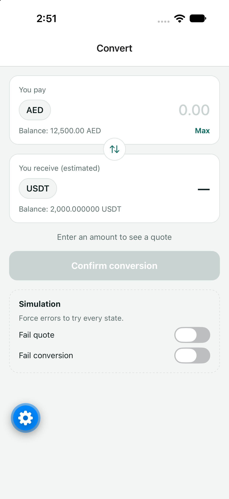
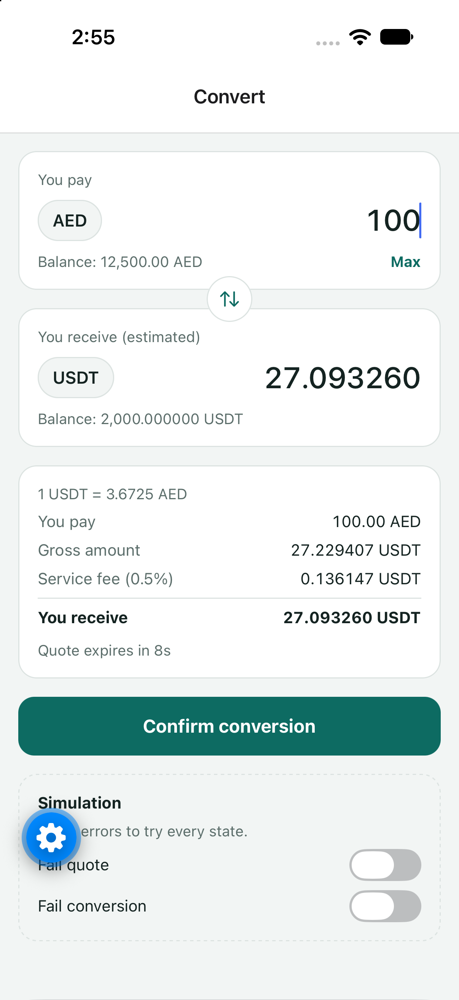
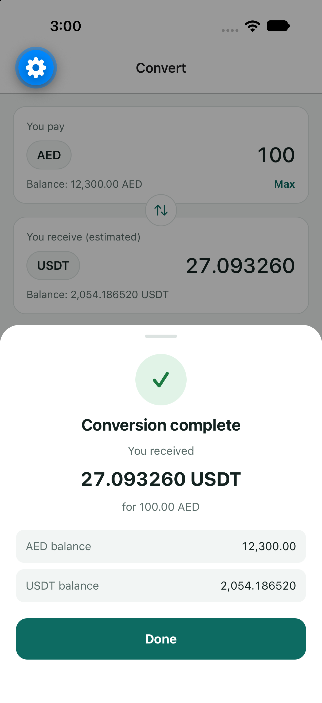
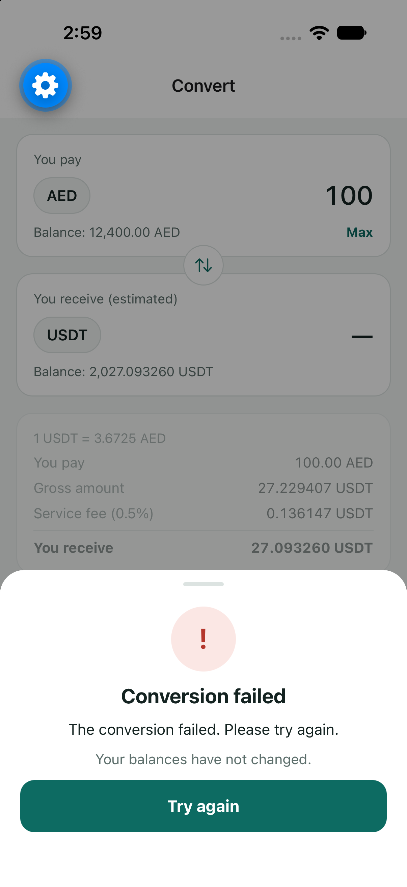

# Asset Conversion

A small React Native app for converting between AED and USDT. You enter an amount, get a quote that's valid for 15 seconds, and confirm it.

<p>
  
  
  
  
</p>

## Running it

Expo (SDK 57) and TypeScript.

```bash
npm install
npx expo start   # scan the QR code with Expo Go, or press i / a for a simulator
npm test
```

## Trying it out

- Type 100 AED → a quote appears after a short pause
- Wait 15 seconds → the quote expires and can be refreshed
- Type more than your balance → validation error, no quote
- Confirm → success sheet, balances update
- Use the **Simulation** switches at the bottom to make the quote or the conversion fail

## How it's organised

```
src/
├── domain/       rates, fee, rounding, validation (pure functions + tests)
├── services/     the conversion "backend" (mocked)
├── store/        balances and simulation switches
├── hooks/        useQuote and useConvert
├── components/   UI pieces
└── app/          the screen
```

Dependencies point inwards (UI → hooks → services → domain). The screen doesn't know the service is mocked, so a real API would only change one file.

## Decisions

- **decimal.js for money.** JS numbers are floating-point and can't store most decimals exactly, so rounding down could lose a cent. decimal.js keeps every amount exact.
- **Display precision.** The brief rounds only the net amount down, but shows the AED fee as `1.83625`. I show gross and fee with up to 6 decimals so the card adds up, and the net always at full asset precision, so "995 USDT" in the brief appears as `995.000000 USDT`.
- **Automatic quotes.** A quote is requested 400 ms after typing stops. The old quote is cleared immediately, so it can't be confirmed for the wrong amount.
- **Stale responses.** The mock answers after a random 0.5–2.5 s, so an older request can finish after a newer one. Each request gets a number, and only the latest one's answer is shown.
- **Expiry.** The countdown is based on the `expiresAt` timestamp, so it survives backgrounding. Expired quotes are blocked by the button, re-checked at tap time, and rejected by the service.
- **Confirming.** The button is disabled while confirming, so a conversion can't be sent twice. Balances update only on success; a failed conversion leaves them unchanged.
- **zustand for shared state.** Balances and the simulation switches are global; everything else is local to the screen and hooks. I chose it over Context because the mock service reads the switches outside React and components only re-render when the value they use changes, and over Redux because that's a lot of setup for two pieces of state.

## Assumptions

- The brief is cut off at "If the entered amount…". I assumed a changed amount discards the quote and requests a new one, and an amount above the balance shows an error.
- With two assets, the pay asset decides the receive asset, so selection is one swap button.
- Amounts must be above 0, within the balance, and within the asset's decimals. Amounts whose net rounds to 0 are rejected.

## Testing

Unit tests cover the three brief examples (exact match) and each validation rule. Hooks and UI were checked by hand with the simulation switches.

## With more time

- Dark mode
- Localisation (translations, Arabic/RTL, local number formats)
